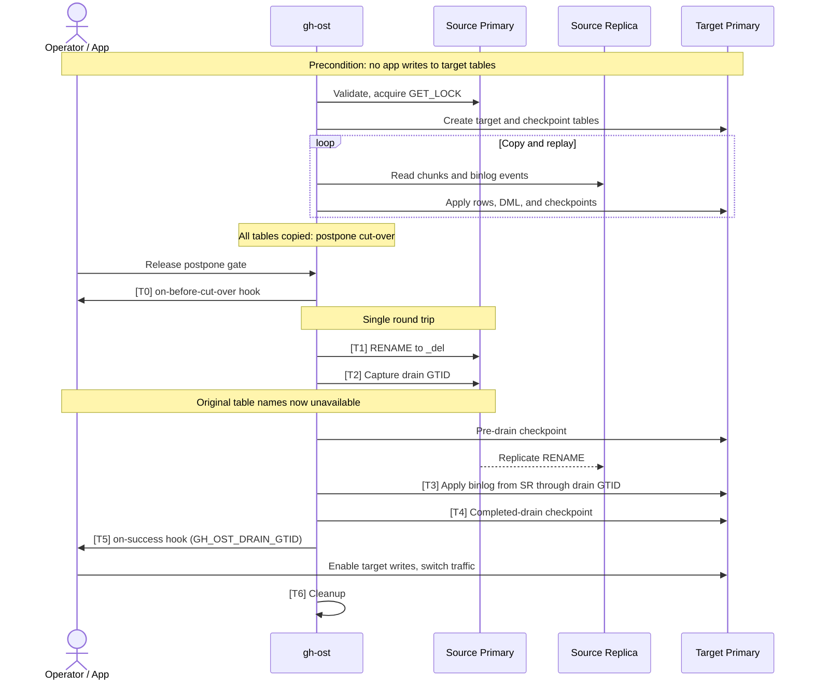

# Move-Tables Design Doc

For setup and recovery procedures, see the [user guide](move-tables.md).

## Architecture

| Aspect | Standard `gh-ost` | Move-tables (`--move-tables`) |
| --- | --- | --- |
| **Scope** | Single table altered in place via `_<table>_gho` | One or more tables copied directly to `--target-host` |
| **Bookkeeping** | `_<table>_ghc` changelog/heartbeat + optional `_<table>_ghk` on source | No `_ghc` table; required checkpoint table on target |
| **Data path** | `INSERT IGNORE ... SELECT` on the source primary | `SELECT` chunks + binlog stream from `--host`, applied to `--target-host` |
| **Cut-over** | Two-session lock + atomic swap with `_<table>_gho` | Source `RENAME TABLE` to `_<table>_del` + drain to the post-rename source GTID |

Schema inspection, row counts, chunk reads, and binlog streaming run on `--host`, normally a source replica. The writable source primary handles the advisory lock, table-type/resume checks, cut-over rename and GTID capture, and deletion-table cleanup.

Tables have independent schema metadata, unique keys, and chunk ranges, but share one binlog streamer and target writer loop. Chunk copies run round-robin; binlog DML takes priority. The target checkpoint table stores one row per table per checkpoint, combining per-table key ranges with run-wide GTID coordinates and cut-over markers.

Source replication to `--host`, gh-ost copy/replay to the target primary, and native target replication to its replicas advance independently. Target throttling does not establish source-replica readiness, and the drain GTID (`GH_OST_DRAIN_GTID`) is a **source** stream coordinate rather than a target replication position.

`GET_LOCK('gh-ost-move-tables', 0)` serializes moves per source primary. It does not lock the target, coordinate with standard OSC, protect overlapping source/target roles, or fence primary failover and external sessions.

## Lifecycle and cut-over (`T0`–`T6`)

Cut-over disables throttling. The `T0`–`T6` labels match code comments, tests, and logs.

| Phase | Behavior |
| --- | --- |
| `T0`: Before-cut-over hook | `gh-ost-on-before-cut-over` runs synchronously; a non-zero exit aborts before source DDL. |
| `T1`: Rename | `RENAME TABLE` moves all source tables to `_<table>_del` in one statement; original names become unavailable. Never retried. |
| `T2`: Capture drain GTID | In the same round trip, reads `@@global.gtid_executed` (MySQL) or `@@global.gtid_binlog_pos` (MariaDB), so the boundary covers every write before the rename. A target checkpoint then records `cutover_started=1`, `is_cutover=0`, and the drain GTID. The round trip is not atomic: if `T1` commits but `T2` or this checkpoint fails, resume refuses and recovery is manual. |
| `T3`: Drain | Polls every `100ms`, up to `--cut-over-lock-timeout-seconds` (default `60s`), until queues are empty, no apply handler is active, and the applier reaches the `T2` GTID. For non-row tail events, streamer progress must hold for two consecutive polls. |
| `T4`: Record completion | Persists `gh_ost_is_cutover=1` and lets the streamer exit. A failed write aborts before `T5`. |
| `T5`: Success hook | `gh-ost-on-success` runs with `GH_OST_DRAIN_GTID`; automation can enable target writes and switch traffic. |
| `T6`: Cleanup | Closes the streamer; keeps or drops source `_<table>_del` tables and the checkpoint table per `--ok-to-drop-table`. |

The sampled drain checks are not a synchronized transaction barrier. The drain timeout excludes rename lock waits, hooks, and routing; it does not cap total outage.

## Correctness and boundaries

### Assumptions

- Target application writes stay disabled until `T4` persists `gh_ost_is_cutover=1`; enable them through or after `gh-ost-on-success`.
- No external DDL alters moved or `_<table>_del` tables during the move or recovery.
- Prior `gh-ost` and hook processes have stopped before `--resume`.
- All source and target hosts use the same database flavor (checked at startup).

### Replay and transaction visibility

Checkpoints record the applier's last applied source position. Replay starts at the earliest per-table coordinate; `INSERT IGNORE` chunks and idempotent DML (`INSERT IGNORE`, `UPDATE`, `DELETE`) allow convergence.

This tracking does **not** preserve source transaction boundaries for target readers. Asynchronous batches can expose partially applied multi-row or cross-table transactions during copying and postponed cut-over.

### Cut-over safety

1. `RENAME TABLE` waits for transactions holding metadata locks on the moved tables. After rename, statements resolving the original names fail unless external DDL recreates them.
2. The post-rename GTID boundary includes preceding writes to every moved table.
3. `T3` checks source progress and observed target apply work before declaring the drain complete.
4. Recording completion before the success hook prevents resume from replaying source changes over application writes the hook may enable.

Because `gh-ost` neither routes traffic nor fences target writes, this is not an atomic cross-cluster handoff. Rename crash atomicity depends on server version and storage engines ([MySQL](https://docs.oracle.com/cd/E17952_01/mysql-8.0-en/atomic-ddl.html), [MariaDB](https://mariadb.com/docs/server/reference/sql-statements/data-definition/rename-table)) and is not validated by `gh-ost`; partial renames require manual recovery.

## Failure boundaries and resume

`--resume` preflight validates target cut-over checkpoints and source primary table state before running `gh-ost-on-startup` or starting binlog streaming:

- **Copy checkpoint (`cutover_started=0`, `is_cutover=0`) + original source `BASE TABLE`s intact:** resumes chunk copying from per-table key ranges and the earliest per-table checkpoint coordinate.
- **Pre-drain checkpoint (`cutover_started=1`, `is_cutover=0`, non-empty drain GTID) + only `_<table>_del` `BASE TABLE`s on source:** resumes replay/drain without repeating the rename, postpone gate, or `gh-ost-on-before-cut-over`, then persists `T4` and runs `gh-ost-on-success`.
- **Fail-closed states:** refuses resume if `gh_ost_is_cutover=1` (target writes may already be enabled), if cut-over coordinates are missing, or if source table state disagrees with checkpoint state (including interruptions between `T1` and the pre-drain checkpoint, or partial renames).

`gh_ost_is_cutover=1` does not prove traffic switched, cleanup errors do not undo cut-over, and `_<table>_del` receives no target-side writes. For operator inspection queries and recovery steps, see the [user guide](move-tables.md#cleanup-and-recovery).
